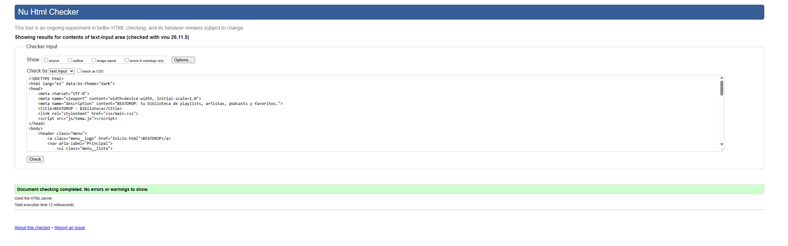
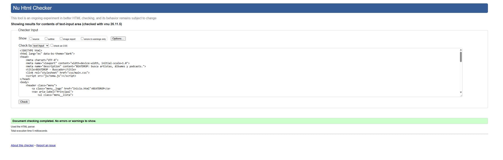
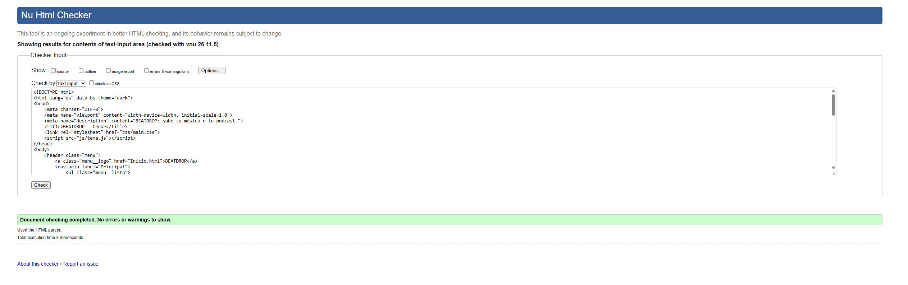
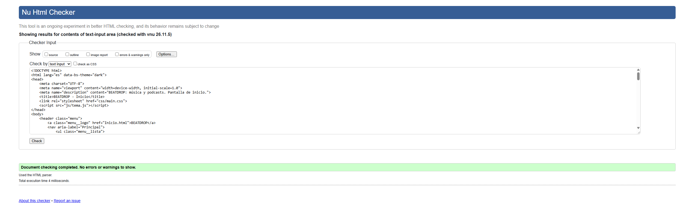
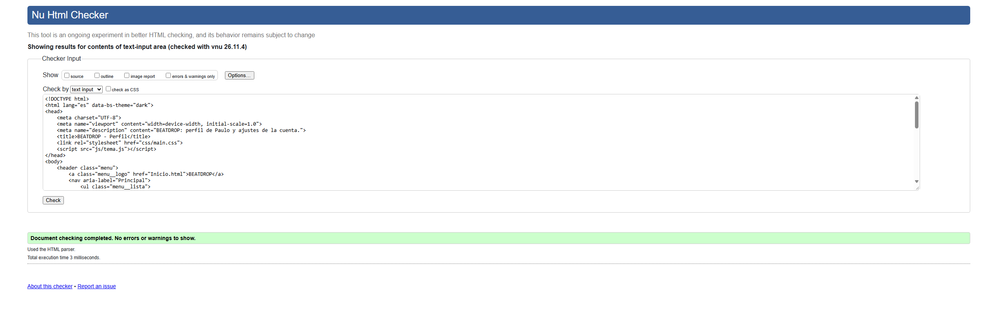
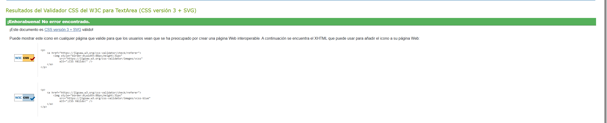
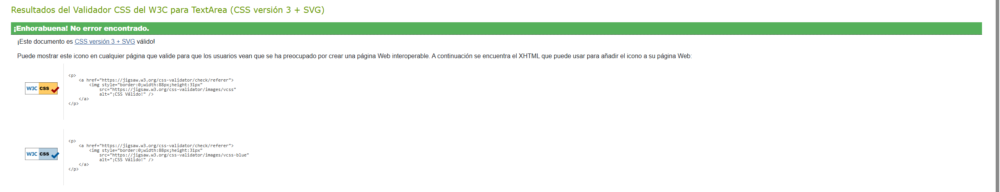
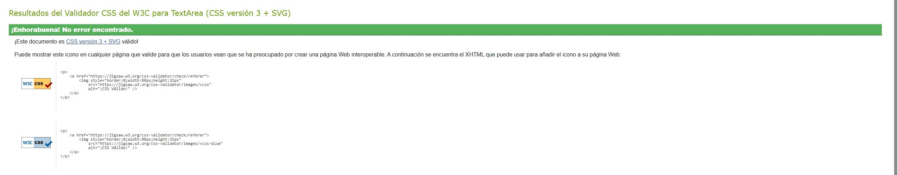
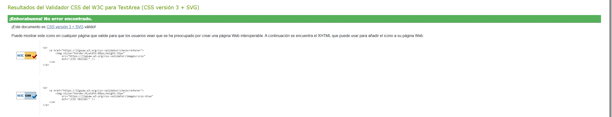
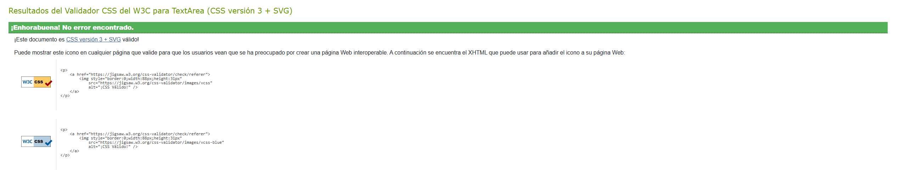

# BEATDROP

Aplicación web de música y podcasts, desarrollada como práctica RA2 del módulo **Desarrollo de Interfaces Web** (Ciclo Formativo de Grado Superior, DAW).

Autor: **Paulo**

---

## Contenido

- [Páginas](#páginas)
- [Estructura del proyecto](#estructura-del-proyecto)
- [Cómo ejecutarlo](#cómo-ejecutarlo)
- [Compilar los estilos (Sass)](#compilar-los-estilos-sass)
- [Arquitectura de estilos](#arquitectura-de-estilos)
- [Modo claro y oscuro](#modo-claro-y-oscuro)
- [Accesibilidad](#accesibilidad)
- [Responsive](#responsive)
- [Validación](#validación)
- [Tecnologías](#tecnologías)

---

## Páginas

| Archivo | Descripción |
|---|---|
| `Inicio.html` | Atajos (Podcast, Mix diario, Cursos, Favoritos), sugerencias de artistas y podcasts. |
| `Buscador.html` | Campo de búsqueda, búsqueda por audio y filtros (género, año, estado de ánimo). |
| `Biblioteca.html` | Pestañas (Playlist, Artistas, Podcast, Favoritos) y creación de playlists en un diálogo. |
| `Crear.html` | Subida de música y de podcasts por clic o arrastrando el archivo. |
| `Perfil.html` | Perfil de usuario, ajustes y cambio de modo claro/oscuro. |

## Estructura del proyecto

```
proyecto RA2 IW/
├── Inicio.html
├── Buscador.html
├── Biblioteca.html
├── Crear.html
├── Perfil.html
├── README.md
├── css/
│   └── main.css          # CSS compilado (lo que cargan las páginas)
├── sass/                 # Código fuente de los estilos
│   ├── main.scss         # Punto de entrada
│   ├── _variables.scss   # Paleta, temas, medidas
│   ├── _mixins.scss      # Funciones reutilizables
│   ├── _tema.scss        # Tokens de color y estilos base
│   ├── _layout.scss      # Contenedor de página y títulos
│   ├── _menu.scss        # Barra de navegación
│   ├── _botones.scss     # Botones
│   ├── _tarjetas.scss    # Superficies reutilizables
│   └── paginas/          # Estilos propios de cada pantalla
│       ├── _inicio.scss
│       ├── _buscador.scss
│       ├── _biblioteca.scss
│       ├── _crear.scss
│       └── _perfil.scss
├── scss/                 # Código fuente de Bootstrap 5.3 (se importa desde sass/)
├── js/
│   ├── tema.js           # Modo claro/oscuro
│   ├── biblioteca.js     # Pestañas y diálogo de playlists
│   ├── crear.js          # Zonas de subida de archivos
│   └── buscador.js       # Formulario de búsqueda
└── img/                  # Imágenes de las portadas
```

## Cómo ejecutarlo

No necesita servidor ni instalación: basta con abrir `Inicio.html` en el navegador. Para probarlo con un servidor local:

```bash
npx serve .
```

## Compilar los estilos (Sass)

Los estilos se escriben en `sass/` y se compilan a `css/main.css`, que es el único archivo que cargan las páginas.

```bash
npm install -g sass
sass sass/main.scss css/main.css --style=compressed --no-source-map
```

Para desarrollar con recompilación automática:

```bash
sass --watch sass/main.scss:css/main.css
```

## Arquitectura de estilos

- **Bootstrap 5.3** se usa para la rejilla (`row`, `col-*`), utilidades (`d-flex`, `gap-3`, `visually-hidden`…) y el sistema de temas (`data-bs-theme`).
- **Variables**: toda la paleta, los temas y las medidas están en `_variables.scss`. Los temas se definen en un mapa (`$temas`) y se convierten en variables CSS (`--color-*`) mediante el mixin `tokens-tema`, así que añadir un tema nuevo no requiere repetir código.
- **Mixins**: `foco`, `movil` (media query) e `interactiva` (hover, pulsación y foco) evitan repetir código.
- **Metodología BEM**: bloques (`menu`, `boton`, `tarjeta`, `atajo`, `galeria`, `playlist`, `subida`…), elementos (`menu__enlace`, `playlist__portada`…) y modificadores (`boton--primario`, `menu__enlace--activo`, `subida--arrastrando`…).
- **Generación con bucles**: los colores de los atajos (`$atajos`) y las portadas de playlist (`$portadas`) se generan con `@each`.
- **Sobrescritura de Bootstrap**: los componentes propios usan clases BEM con la misma especificidad que Bootstrap y se cargan después, así que tienen prioridad. El bloque `.dialogo` se llama así para no chocar con la clase `.modal` de Bootstrap.

## Modo claro y oscuro

- El tema se controla con el atributo `data-bs-theme` del `<html>` (oscuro por defecto).
- El botón de **Perfil** alterna entre ambos modos y la elección se guarda en `localStorage`.
- `js/tema.js` se carga en el `<head>` para aplicar el tema antes de pintar la página y evitar parpadeos.
- Todos los pares texto/fondo cumplen un contraste mínimo de **4,5:1** (WCAG AA) en ambos temas.

## Accesibilidad

- Estructura semántica: `header`, `nav` con `aria-label`, `main`, `section` con `aria-labelledby`, `article`, `figure`/`figcaption`.
- Navegación actual indicada con `aria-current="page"`.
- Pestañas con el patrón ARIA `tablist` / `tab` / `tabpanel`, manejables con las flechas del teclado.
- Diálogo nativo `<dialog>`: el navegador gestiona el foco y lo cierra con Escape; `js/biblioteca.js` lo abre con `showModal()`.
- Anillo de foco visible (`:focus-visible`) en todos los controles interactivos.
- Campos de formulario con etiqueta, incluidos los ocultos visualmente pero accesibles con teclado.
- Las imágenes tienen texto alternativo y las decorativas usan `aria-hidden`.

## Responsive

Diseñado primero para escritorio y adaptado a móvil (por debajo de 640 px):

- El menú se apila en vertical y sus enlaces se reparten en varias líneas.
- Las rejillas de Bootstrap cambian de número de columnas según el ancho: en Inicio, de 1 a 2 (atajos) y de 2 a 3 (galerías); en Biblioteca, de 2 a 4.
- Las galerías y las portadas ajustan su tamaño sin desbordar la página.

## Validación

### HTML (Nu Html Checker de W3C)


| Página | Resultado |
|---|---|
| `Inicio.html` | Sin errores ni advertencias |
| `Buscador.html` | Sin errores ni advertencias |
| `Biblioteca.html` | Sin errores ni advertencias |
| `Crear.html` | Sin errores ni advertencias |
| `Perfil.html` | Sin errores ni advertencias |







### CSS (Validador CSS de W3C)







## Tecnologías

- HTML5
- Sass (SCSS) con arquitectura por partials, variables, mixins y bucles
- Bootstrap 5.3 (rejilla, utilidades y temas)
- JavaScript (ES2015+), sin dependencias externas
- Metodología BEM
